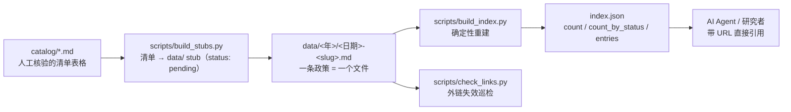

# 中国政策雷达 · China Policy Radar

> **非官方项目（Unofficial）** · 本仓库与中国政府机关无任何隶属或合作关系。
> 把中国的政策文件变成**结构化、可追溯、机器可读**的数据层。
> 每条结论都带原始出处链接。没有引用，不予收录。
>
> 覆盖口径：**14 条已结构化（含条款级原文摘录）＋ 76 条为带一手链接的索引条目（`status: pending`，条款未补录）**。
> 实时数字以 `index.json` 的 `count_by_status` 为准；pending 条目**不得**用于任何条款性表述。

A machine-readable, source-cited index of Chinese policy documents — built for humans **and AI agents**.

[]() []()

**⚖️ [免责声明](DISCLAIMER.md)** · **[采集合规说明](COMPLIANCE.md)** · **[授权说明](LICENSE)**

> 本仓库内容不构成投资建议、法律意见或申报依据。政策文本以官方发布为准。

---

## 为什么存在这个仓库

政策解读的文章每天有几百篇，但**没有一篇能被机器可靠地引用**——它们没有原文链接、没有条款定位、没有版本对比。

这个仓库做三件别人不做的事：

1. **一手原文 + 可追溯引用**：不转述、不洗稿，每条都是一手文件的结构化摘录，附官方来源 URL
2. **政策 Diff**：追踪同一主题文件的版本演进——哪条是新加的，哪条被删了
3. **落地链条**：中央文件 → 部委细则 → 地方实施方案，三级对照

## 目录结构

```
data/<年>/<发布日期>-<slug>.md     一条政策 = 一个文件
catalog/                          自动生成的历年政策清单
topics/                           专题（OPC 一人公司等）
frameworks/                       通用分析框架
diffs/<政策族>.md                  同一主题文件的措辞演进追踪
scoreboard/<政策>.md               政策发布后的回测记分牌
schema/policy.schema.json         数据格式定义
scripts/fetch_gov.py              抓取单篇政策原文
scripts/watch_gov.py              政策巡检（发现新文件）
scripts/build_catalog.py          生成政策清单
scripts/build_index.py            生成机器可读索引
scripts/build_stubs.py            catalog → data stub 生成（status: pending）
scripts/check_links.py            外链失效巡检
state/seen.json                   巡检状态（已知文件）
DATA-SOURCES.md                   六环证据链数据源矩阵
ROADMAP.md                        长线路线图
index.json                        机器可读索引（给 AI agent）
sitemap.md                        全部入口一览
AGENTS.md                         给 AI agent 的接入说明
llms.txt                          站点说明（GEO）
DISCLAIMER.md / COMPLIANCE.md / LICENSE / CORRECTIONS.md / CONTRIBUTING.md   治理文件
```

## 现在可以看到什么

- **[🧭 赛道进入评估框架](frameworks/sector-entry-evaluation.md)**：退出残值判据——判断任何方向值不值得下注（含餐饮 vs OPC 对比）
- **[🎯 可申报通道清单](CHANNELS.md)**：从两份专项行动文件提取的资金与项目通道（含 600.6 亿国家 AI 产业投资基金）
- **[📌 专题：OPC 一人公司](topics/OPC-one-person-company.md)**：国家/省/市政策 16 份 + [案例清单](topics/OPC-cases.md) + [海外对照](topics/OPC-overseas.md)
- **[政策清单](catalog/2024-now-central-policies.md)**：2024 年至今中央及部委政策，全部带原文链接（结构化条数以 `index.json` 的 `count` / `count_by_status` 为准，不在此处硬编码）
- **[人工核验清单](catalog/central-ai-tech-2024-2026.md)**：27 份重点文件，逐页核对
- **[「人工智能+」政策族](diffs/AI-plus-timeline.md)**：用词演进（开展→持续推进→深入实施→全面实施→深化拓展）+ **13 份部委逐行业专项文件**
- **[「人工智能+制造」结构化](data/2025/2025-12-25-ai-plus-manufacturing.md)**：7 大任务 21 项措施 + 2 附件
- **[「人工智能+软件」结构化](data/2026/2026-09-11-ai-plus-software.md)**：6 方面 19 项任务
- **[2026-11-21 结构化批次](docs/structure-batch-2026-11-21.md)**：11 份「人工智能+」行业文件补录条款，44 段引用逐字校验
- **[回测记分牌](scoreboard/2026-10-09-xin-zhi-shengchanli.md)**：新质生产力意见的 T0 基线数据与观察节点


## 数据流水线（可复算，不靠人肉同步）



铁律：`data/` 是唯一事实层，`index.json` 是它的确定性投影；两者不一致视为 bug（见 `CORRECTIONS.md` C-004）。

## AI Agent 30 秒接入

```bash
# 1) 拉索引（机器可读，含 count_by_status 与每条的一手来源 URL）
curl -s https://raw.githubusercontent.com/Focus688/china-policy-radar/master/index.json \
  | python3 -c "import json,sys; d=json.load(sys.stdin); print(d['count'], d['count_by_status'])"

# 2) 按主题过滤（示例：人工智能+）
curl -s https://raw.githubusercontent.com/Focus688/china-policy-radar/master/index.json \
  | python3 -c "import json,sys; d=json.load(sys.stdin); \
[print(e['date'], e['title'][:40], e['sources'][0]['url']) for e in d['entries'] if '人工智能' in e.get('title','')][:5]"
```

引用任何一条时请连同 `sources[0].url` 一起给出——没有 URL 的转述不进本仓库，也不应被引用。

## 数据规范（摘要）

每条政策记录必须包含：

| 字段 | 说明 |
|---|---|
| `title` | 文件全称，与原文一致 |
| `issuer` | 发文机关 |
| `date` | 印发日期（YYYY-MM-DD） |
| `sources[]` | **至少一个一手来源 URL**（gov.cn / 新华社 / 部委官网）|
| 条款摘录 | 见正文「重点条款原文摘录」小节，逐字取自原文并按条编号（`clauses[]` 机器字段尚未落库，勿按 schema 假定其存在） |
| `tags[]` | 主题标签 |

> 铁律：**没有一手来源 URL 的条目，一律不收。** 宁可少，不可假。
>
> status 语义：`structured` = 含条款级原文摘录；`pending` = 仅元数据 + 一手链接，条款未补录，禁止据其内容作条款性表述。

## 免责声明

本项目仅整理**公开发布**的政府文件原文与公开数据，供研究与信息检索使用。
所有分析不构成投资建议。政策文本以官方发布为准。

## License

文档内容 CC BY 4.0；脚本代码 MIT。

---
## Focus688 Open Source Matrix

| 项目 | 定位 | 解决什么问题 |
|---|---|---|
| [**agent-security-skills**](https://github.com/Focus688/agent-security-skills) | Agent 安全之「盾」 | 生产 Agent 运维安全技能库：安全安装、静默故障巡检、MCP 权限与 SKILL.md 供应链审计 |
| [**agent-enhancement-playbook**](https://github.com/Focus688/agent-enhancement-playbook) | Agent 增强之「矛」 | 证据分级的生产 Agent 增强手册：C1-C8 有效组合、K1-K9 反模式、12 维实机账本与可执行模板 |
| [**china-policy-radar**](https://github.com/Focus688/china-policy-radar) | 垂直情报活水层 | 结构化、带一手官方链接、机器可读的中国政策索引、跨版本 Diff 与回测记分牌 **← 当前仓库** |
| [**paper-repro**](https://github.com/Focus688/paper-repro) | 无代码论文复现 | 低预算独立复现/证伪无官方代码热门论文：源码 + 复现报告 + 全量日志可追溯 |
| [**levi-focus**](https://focus688.github.io/levi-focus/) | 研究与矩阵总站 | 实弹供应链审计报告、复现拆解文章与 GEO 入口（[GitHub](https://github.com/Focus688/levi-focus)） |
